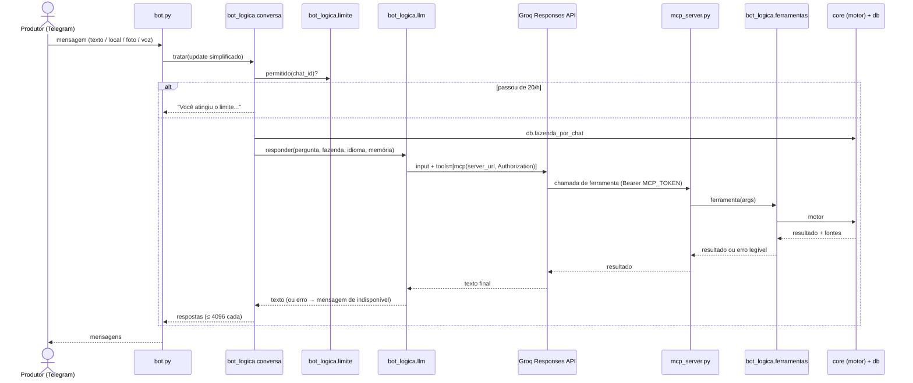

# Bot Design

**Spec**: `.specs/features/bot/spec.md`
**Status**: Draft

---

## Architecture Overview

Dois processos sobre o mesmo núcleo e o mesmo `db.sqlite` (AD-001). `mcp_server.py` expõe as ferramentas do motor por HTTP (Streamable HTTP do `MCPServer`, mcp 2.3) atrás de um middleware que exige o token. `bot.py` recebe as mensagens do Telegram e entrega cada uma a uma função pura de `bot_logica/`, que decide a resposta usando LLM, motor e banco injetados — por isso tudo é testável com fakes, sem rede. A LLM é a Groq (AD-002): Responses API com Remote MCP; plano B por function calling local com as mesmas ferramentas. Todo número sai do motor (AD-004). Escolha do usuário: "2 processos + lógica pura (Recommended)".



---

## Code Reuse Analysis

### Existing Components to Leverage

| Component | Location | How to Use |
| --------- | -------- | ---------- |
| Cache atômico | `core/cache.py` (feito) | `core/recente.py` grava com o mesmo helper |
| Conversão da resposta do POWER | `core/power.py` (feito) | `recente` reusa a conversão para as mesmas colunas |
| Validação | `core/validacao.py` (feito) | lat/lon e datas |
| Exceções | `core/erros.py` (feito) | Mensagens de erro das ferramentas |
| Culturas | `core/culturas.py` (feito) | `info_cultura`, validação de `/alerta` |
| Balanço hídrico | `core/balanco.py` (motor T10, pendente) | `alertas` usa o mesmo Ks e as fases da cultura |
| Contratos do motor | `core/contexto.py`, `core/clima.py`, `core/modelo.py` (motor T13–T17, pendentes) | Ferramentas do MCP |

### Integration Points

| System | Integration Method |
| ------ | ------------------ |
| Telegram | python-telegram-bot 22.8, polling; `JobQueue.run_daily` para alertas |
| Groq | SDK `openai` 3.51 com `base_url="https://api.groq.com/openai/v1"`; Responses API com ferramenta `type: "mcp"` (beta) — campos exatos confirmados na T9 |
| MCP | `mcp.server.mcpserver.MCPServer` (mcp 2.3) + `streamable_http_app()` (Starlette) + middleware de token + uvicorn |
| Site | `core/db.py` (`criar_fazenda`, `listar_observacoes`) — SITE-32..36 |

---

## Components

### core.db
- **Purpose**: Banco compartilhado.
- **Location**: `core/db.py`
- **Interfaces**: `criar_fazenda(lat, lon, pais, chat_id=None) -> int` · `fazenda_por_chat(chat_id) -> dict|None` · `fazenda(id) -> dict|None` · `vincular_chat(id, chat_id)` · `atualizar_local(id, lat, lon, pais)` · `salvar_observacao(fazenda_id, texto, foto_path, descricao_ia) -> int` · `listar_observacoes() -> list[dict]` · `inscrever_alerta(fazenda_id, cultura, data_plantio) -> int` · `listar_alertas(ativos=True) -> list[dict]` · `marcar_alerta_enviado(id, quando)`; caminho via `DB_PATH` (padrão `db.sqlite`)
- **Dependencies**: `sqlite3`

### core.recente
- **Purpose**: Últimos 45 dias do POWER com cache de 1 dia (BOT-39).
- **Location**: `core/recente.py`
- **Interfaces**: `serie(lat, lon, dias=45, hoje=None) -> DataFrame` (mesmas colunas de `power.serie`); cache `cache/recente_{lat:.2f}_{lon:.2f}_{AAAAMMDD}.json`
- **Dependencies**: `core.power` (conversão), `core.cache`, `requests`

### core.alertas
- **Purpose**: Situação hídrica atual e verificação de alertas (BOT-30, BOT-36..38).
- **Location**: `core/alertas.py`
- **Interfaces**: `situacao(lat, lon, cultura, data_plantio, hoje) -> {ks, dias_ate_meio, alerta: bool}` · `verificar(db, hoje, forcar=False, chat_id=None) -> list[{chat_id, alerta_id, mensagem_chave, valores}]`
- **Dependencies**: `core.recente`, `core.balanco`, `core.solo`, `core.culturas`, `core.db`

### bot_logica.ferramentas
- **Purpose**: As 8 ferramentas como funções que devolvem resultado ou erro legível, e seus schemas JSON (usados pelo MCP e pelo plano B).
- **Location**: `bot_logica/ferramentas.py`
- **Interfaces**: `FERRAMENTAS: dict[nome, {funcao, descricao_pt_en, schema}]` · `executar(nome, args) -> dict` (`{"erro": msg}` em exceção)
- **Dependencies**: `core.*` (injetável)

### mcp_server
- **Purpose**: Servidor MCP HTTP com token (BOT-09, BOT-11).
- **Location**: `mcp_server.py`
- **Interfaces**: `criar_app(token) -> Starlette` · `main()` (uvicorn, porta `MCP_PORT` padrão 8000, caminho `/mcp`)
- **Dependencies**: `mcp.server.mcpserver.MCPServer`, `starlette`, `uvicorn`, `bot_logica.ferramentas`

### bot_logica.idioma
- **Purpose**: `language_code` → pt/en/es e textos fixos do bot.
- **Location**: `bot_logica/idioma.py`
- **Interfaces**: `idioma(language_code) -> "pt"|"en"|"es"` · `t(chave, idioma, **v)`

### bot_logica.limite
- **Purpose**: 20 mensagens por usuário em 60 min (BOT-24).
- **Location**: `bot_logica/limite.py`
- **Interfaces**: `Limite(maximo=20, janela_s=3600, relogio=time.time)` · `permitir(chat_id) -> bool`

### bot_logica.llm
- **Purpose**: Falar com a Groq (BOT-19, BOT-20, BOT-23, BOT-25, BOT-26).
- **Location**: `bot_logica/llm.py`
- **Interfaces**: `prompt_sistema(fazenda, idioma) -> str` · `Memoria(n=6)` · `Assistente(cliente, modelo, mcp_url, mcp_token, remoto=True, ferramentas=FERRAMENTAS)` · `responder(chat_id, pergunta, fazenda, idioma) -> str` (levanta `LLMIndisponivel` em falha/timeout 30 s/limite)
- **Dependencies**: cliente compatível com OpenAI (injetável)

### bot_logica.conversa
- **Purpose**: Fluxos de texto, comandos e localização (BOT-15..18, BOT-21, BOT-33, BOT-34, BOT-40, BOT-44, BOT-45).
- **Location**: `bot_logica/conversa.py`
- **Interfaces**: `Conversa(db, motor, assistente, limite, alertas)` · `start(chat_id, args, lang)` · `localizacao(chat_id, lat, lon, lang)` · `texto(chat_id, texto, lang)` · `alerta(chat_id, args, lang)` · `testar_alerta(chat_id, lang)` → `list[str]` · `dividir(texto, 4096)`

### bot_logica.fotos
- **Purpose**: Fluxo de foto (BOT-27..32).
- **Location**: `bot_logica/fotos.py`
- **Interfaces**: `tratar_foto(chat_id, conteudo: bytes, legenda, lang, agora) -> list[str]` com `descrever(bytes, idioma)` injetado

### bot_logica.audio
- **Purpose**: Fluxo de voz (BOT-41, BOT-42).
- **Location**: `bot_logica/audio.py`
- **Interfaces**: `tratar_voz(chat_id, conteudo: bytes, lang) -> list[str]` com `transcrever(bytes)` injetado e reuso de `Conversa.texto`

### bot
- **Purpose**: Liga Telegram aos fluxos, agenda alertas e checa o ambiente (BOT-35, BOT-43).
- **Location**: `bot.py`
- **Interfaces**: `verificar_ambiente(env) -> None` (sai com a variável ausente) · `agendar(job_queue, verificar)` (10:00 UTC) · `main()`

---

## Data Models

```sql
CREATE TABLE IF NOT EXISTS fazendas (
  id INTEGER PRIMARY KEY, lat REAL NOT NULL, lon REAL NOT NULL, pais TEXT,
  chat_id TEXT UNIQUE, criado_em TEXT NOT NULL);
CREATE TABLE IF NOT EXISTS observacoes (
  id INTEGER PRIMARY KEY, fazenda_id INTEGER NOT NULL REFERENCES fazendas(id),
  data TEXT NOT NULL, texto TEXT, foto_path TEXT, descricao_ia TEXT);
CREATE TABLE IF NOT EXISTS alertas (
  id INTEGER PRIMARY KEY, fazenda_id INTEGER NOT NULL REFERENCES fazendas(id),
  cultura TEXT NOT NULL, data_plantio TEXT NOT NULL, ativo INTEGER NOT NULL DEFAULT 1,
  ultimo_envio TEXT);
```

`chat_id UNIQUE` garante uma fazenda por chat. Datas em ISO 8601 UTC.

---

## Error Handling Strategy

| Error Scenario | Handling | User Impact |
| -------------- | -------- | ----------- |
| Groq falha / timeout 30 s / limite | `LLMIndisponivel` → texto BOT-25 | "O assistente está indisponível agora…" |
| Remote MCP em beta não funciona | `USE_REMOTE_MCP=false` → plano B local (BOT-26) | Nenhum |
| MCP sem token | 401 antes de qualquer ferramenta | — |
| Motor levanta erro numa ferramenta | `{"erro": mensagem}` | LLM explica o problema |
| Ponto fora de terra | Texto BOT-44, fazenda anterior mantida | Pede outra localização |
| Transcrição falha | Texto BOT-42 | Pede para escrever |
| Variável de ambiente ausente | Processo sai com o nome dela | Só o time vê |

---

## Risks & Concerns

| Concern | Location (file:line) | Impact | Mitigation |
| ------- | -------------------- | ------ | ---------- |
| Campos do Remote MCP da Groq (beta) não confirmados | `bot_logica/llm.py` | Bot sem ferramentas | T9 começa conferindo a doc atual; plano B (T10) pronto e testado |
| `mcp` 2.x renomeou `FastMCP` para `MCPServer`; guias do Notion citam FastMCP | `mcp_server.py` | Código de exemplo errado | Design usa `MCPServer`; avisar o Vinicius |
| Alertas e ferramentas dependem do motor T10–T17 (pendente) | `core/alertas.py`, `bot_logica/ferramentas.py` | Bot real sem números | Testes com motor falso; integração real após o motor |
| URL pública do MCP (ngrok) muda a cada reinício | `.env` | Groq perde o servidor | `MCP_PUBLIC_URL` no `.env`; verificação no deploy |
| Contador de limite em memória zera ao reiniciar | `bot_logica/limite.py` | Limite contornável reiniciando | Aceito no MVP (assumption) |
| Dados pessoais (fotos, local) guardados até o fim do evento | `db.sqlite`, `data/fotos/` | Privacidade | Aviso no /start; BOT-08 concentra tudo em 2 lugares para apagar |

---

## Tech Decisions

| Decision | Choice | Rationale |
| -------- | ------ | --------- |
| Token do MCP | Middleware Starlette comparando `Authorization` com `hmac.compare_digest` | Comparação em tempo constante; 401 antes do MCP |
| Testes do MCP | `starlette.testclient.TestClient` sobre `criar_app` | Prova o 401 e a listagem sem rede |
| Testes do bot | Funções de `bot_logica` com fakes; `bot.py` testado só em `verificar_ambiente` e `agendar` | Sem Telegram real |
| Ferramentas compartilhadas | Mesmo `FERRAMENTAS` alimenta MCP e plano B | Uma fonte da verdade |
