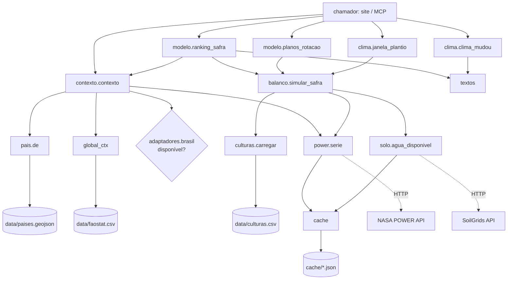

# Motor Design

**Spec**: `.specs/features/motor/spec.md`
**Status**: Draft

---

## Architecture Overview

Funções puras em módulos pequenos de `core/`. Só `power`, `solo` e `pais` tocam o mundo externo (rede ou arquivo); todo o cálculo recebe DataFrames e dicts e é testável sem rede. Conforma a AD-001 (núcleo sem tela/bot/LLM), AD-003 (3 camadas) e AD-004 (todo número sai daqui com `fontes`). Abordagem escolhida pelo usuário: implementação própria FAO-56 simplificada.

---

## Code Reuse Analysis

### Existing Components to Leverage

| Component | Location | How to Use |
| --------- | -------- | ---------- |
| Parâmetros das culturas | `data/culturas.csv` | Lido por `culturas.carregar()`; colunas já definidas (28) |
| Docstrings de contrato | `core/*.py` | Substituídas pela implementação; contratos mantidos |
| Bibliotecas | `requirements.txt` | requests, pandas, numpy, shapely, pytest (+ ruff a adicionar) |

Não há código de domínio existente — repositório recém-estruturado.

### Integration Points

| System | Integration Method |
| ------ | ------------------ |
| NASA POWER | GET `https://power.larc.nasa.gov/api/temporal/daily/point` (JSON), timeout 120 s |
| SoilGrids v2.0 | GET `https://rest.isric.org/soilgrids/v2.0/properties/query` (JSON) |
| Natural Earth | Arquivo `data/paises.geojson` baixado uma vez, lido com `json` + `shapely` |
| Site e MCP (features 2 e 3) | Importam as funções públicas de `core/` |

---

## Components

### erros
- **Purpose**: Exceções do domínio.
- **Location**: `core/erros.py`
- **Interfaces**: `ErroFonteDados(Exception)`, `ErroPontoInvalido(Exception)`
- **Dependencies**: nenhuma

### cache
- **Purpose**: Ler e gravar JSON em `cache/` de forma atômica.
- **Location**: `core/cache.py`
- **Interfaces**:
  - `caminho(prefixo: str, lat: float, lon: float) -> Path` — `cache/{prefixo}_{lat:.2f}_{lon:.2f}.json`
  - `ler(path) -> dict | None` — `None` se não existe ou JSON inválido (MOT-06)
  - `gravar(path, dados: dict) -> None` — grava em `*.tmp` e `os.replace` (MOT-07)
- **Dependencies**: stdlib

### validacao
- **Purpose**: Validar entradas comuns.
- **Location**: `core/validacao.py`
- **Interfaces**: `ponto(lat, lon) -> None` (MOT-08) · `data_mmdd(s) -> (mes, dia)` (MOT-33) · `pesos(prioridades) -> dict` (MOT-31, MOT-32)
- **Dependencies**: stdlib

### textos
- **Purpose**: Frases em pt/en/es com fallback para en (MOT-58).
- **Location**: `core/textos.py`
- **Interfaces**: `t(chave: str, idioma: str, **valores) -> str`
- **Dependencies**: stdlib

### culturas
- **Purpose**: Carregar `culturas.csv` e dizer se uma cultura tem todos os parâmetros do modelo.
- **Location**: `core/culturas.py`
- **Interfaces**: `carregar(path=None) -> dict[str, dict]` · `completa(c: dict) -> bool` (MOT-34) · `CAMPOS_MODELO`
- **Dependencies**: pandas

### power
- **Purpose**: Série diária do NASA POWER com cache (MOT-01..05, MOT-13).
- **Location**: `core/power.py`
- **Interfaces**: `serie(lat, lon) -> DataFrame[data, chuva, tmax, tmin, rad, umid_solo]`
- **Dependencies**: requests, pandas, cache, validacao, erros

### solo
- **Purpose**: Água disponível no solo (MOT-09, MOT-10).
- **Location**: `core/solo.py`
- **Interfaces**: `agua_disponivel(lat, lon) -> {cad_mm, argila_pct, areia_pct, fonte}`
- **Dependencies**: requests, cache, validacao

### pais
- **Purpose**: País e hemisfério offline (MOT-11, MOT-12).
- **Location**: `core/pais.py`
- **Interfaces**: `de(lat, lon, path=None) -> {iso2, nome, hemisferio}`
- **Dependencies**: shapely, json

### balanco
- **Purpose**: FAO-56 simplificado: Ra, ET0, Kc diário, balanço hídrico e perda de uma safra.
- **Location**: `core/balanco.py`
- **Interfaces**:
  - `ra_mm(lat, dia_ano) -> float` (FAO-56 eq. 21 × 0.408)
  - `et0_hargreaves(tmax, tmin, ra) -> float` (MOT-22)
  - `kc_diario(cultura, dia) -> float` (MOT-23)
  - `simular_safra(serie, cultura, cad_mm, inicio: date) -> {perda, quebra, eta, etc}` (MOT-24..26, MOT-59, MOT-60)
- **Dependencies**: numpy, pandas

### clima
- **Purpose**: Estação chuvosa, "seu clima mudou" e janela de plantio.
- **Location**: `core/clima.py`
- **Interfaces**: `clima_mudou(lat, lon, idioma="pt")` (MOT-14..20) · `janela_plantio(lat, lon, cultura)` (MOT-51..54) · `estacao(serie_ano, hemisferio) -> (inicio, fim) | None`
- **Dependencies**: power, pais, balanco, solo, textos

### global_ctx
- **Purpose**: Produtividade e preço por país (MOT-55, MOT-56).
- **Location**: `core/global_ctx.py`
- **Interfaces**: `linhas_pais(iso2) -> dict[cultura, {produtividade_t_ha, preco_usd_t}]` · `retorno(iso2, cultura, perda_media) -> (valor|None, moeda|None)`
- **Dependencies**: pandas

### contexto
- **Purpose**: Melhor fonte disponível por ponto (MOT-37..42, MOT-57).
- **Location**: `core/contexto.py`
- **Interfaces**: `contexto(lat, lon) -> {pais, culturas, fontes, nivel_precisao, classe_climatica}` · `classe_climatica(serie) -> str`
- **Dependencies**: pais, power, solo, global_ctx, culturas, adaptadores.brasil (opcional)

### modelo
- **Purpose**: Ranking de 1 safra e planos de 3 anos.
- **Location**: `core/modelo.py`
- **Interfaces**: `ranking_safra(lat, lon, data_semeadura, prioridades=None, idioma="pt")` (MOT-21, MOT-27..36) · `planos_rotacao(lat, lon, historico, prioridades=None, idioma="pt")` (MOT-43..50)
- **Dependencies**: contexto, balanco, power, solo, culturas, global_ctx, validacao, textos

### adaptadores.brasil
- **Purpose**: Gancho do adaptador nacional (MOT-57).
- **Location**: `core/adaptadores/brasil.py`
- **Interfaces**: `dados(lat, lon) -> {culturas: list, produtividade: dict, preco: dict} | None` — `None` enquanto não houver `data/brasil_municipal.csv`
- **Dependencies**: pandas

---

## Data Models

### Série diária (DataFrame)
| coluna | tipo | origem POWER |
| ------ | ---- | ------------ |
| data | datetime64 | chave `YYYYMMDD` |
| chuva | float mm | PRECTOTCORR |
| tmax | float °C | T2M_MAX |
| tmin | float °C | T2M_MIN |
| rad | float MJ/m²/dia | ALLSKY_SFC_SW_DWN |
| umid_solo | float 0–1 | GWETROOT |

### Cultura (linha do `culturas.csv`)
`CAMPOS_MODELO = dias_ini, dias_des, dias_mid, dias_fim, kc_ini, kc_mid, kc_fim, raiz_m, p_deplecao, ky` — todos obrigatórios para a cultura entrar no cálculo. Usados também: `papel, familia, fixa_n, climas, t_min_c, nota_solo`.

### Item do ranking
`{cultura, nota, risco_pct, anos_quebra, nota_solo, retorno, moeda, explicacao}`; resposta `{itens, culturas_ignoradas, fontes}`.

### Plano
`{plano: [c1, c2, c3], nota, risco_pct, nota_solo, retorno_ano, moeda, atual, explicacao}`; resposta `{itens, culturas_ignoradas, fontes}`.

---

## Error Handling Strategy

| Error Scenario | Handling | User Impact |
| -------------- | -------- | ----------- |
| POWER fora/lento, sem cache | `ErroFonteDados("NASA POWER ...")` | Site/bot mostram "dados da NASA indisponíveis" |
| SoilGrids fora, sem cache | `cad_mm=100`, `fonte="padrão"` | Recomendação sai com selo de solo padrão |
| Cache corrompido | Apaga e busca de novo | Nenhum |
| Ponto no mar | `ErroPontoInvalido("ponto fora de terra")` | Mensagem pedindo outro ponto |
| Entrada inválida (lat/lon, data, pesos, histórico) | `ValueError` com o campo | Mensagem de validação |
| Cultura sem parâmetros | Excluída, listada em `culturas_ignoradas` | Ranking menor, transparente |

---

## Risks & Concerns

| Concern | Location (file:line) | Impact | Mitigation |
| ------- | -------------------- | ------ | ---------- |
| Só 5 de 20 culturas têm parâmetros e nenhuma tem dias por fase | `data/culturas.csv:1` | Ranking real sairia vazio | MOT-34 exclui com transparência; testes de unidade usam culturas de fixture; checks de integração dependem da validação do Matheus (bloqueio externo) |
| Cache dos 4 pontos e `paises.geojson` exigem internet fora da rede corporativa | `cache/`, `data/` | Testes de integração não rodam nesta máquina | Download feito pelo Nascimento em outra rede; integração vira a última tarefa |
| Laço diário em Python para 125 planos × 28 janelas | `core/modelo.py` | Pode passar de 10 s | Pré-calcular por cultura e ano de semeadura uma vez e reutilizar nos planos; check de tempo (MOT-50) |
| Critérios de estação são simplificação | `core/clima.py` | Regiões bimodais (Nakuru) ficam aproximadas | Registrado em Assumptions; modo "anual" como fallback |

---

## Tech Decisions

| Decision | Choice | Rationale |
| -------- | ------ | --------- |
| Rede nos testes de unidade | `requests` substituído por fake via `monkeypatch` | Testes rápidos e determinísticos, sem internet |
| Dados de teste | Séries sintéticas em `tests/conftest.py` e mini `paises.geojson` de fixture | Prova cada fórmula com valores calculáveis à mão |
| Planos de 3 anos | Reaproveitar a perda de cada (cultura, ano) calculada uma vez | Mantém < 10 s |
| Novos módulos | `erros`, `cache`, `validacao`, `textos`, `culturas`, `balanco` | Cada um com uma responsabilidade; `balanco` isola as fórmulas para teste |
