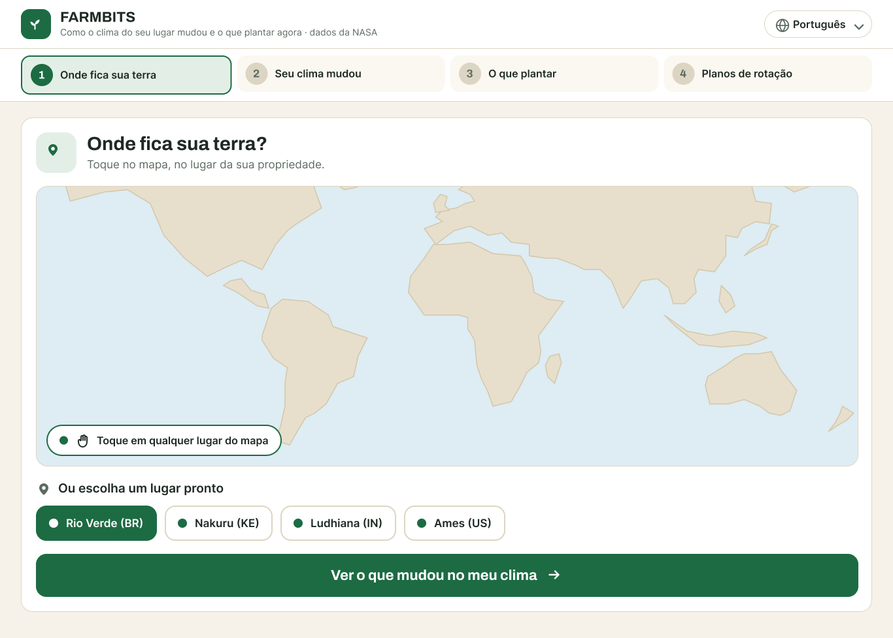
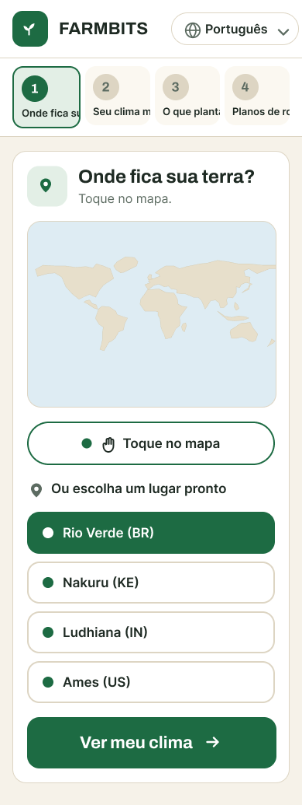

# Site — Onde fica sua terra?

**Approved**: 2026-11-15 - user: "Sim, lembrando que o nome da branch e dos commits devem ser em inglês"

## Problem Statement

A primeira entrega do site público FARMBITS permite que a pessoa localize sua terra no mapa-múndi ou escolha um exemplo. A tela em Streamlit segue o redesenho do Figma para desktop e celular.

## Goals

- Reproduzir a abertura do Figma nas duas larguras de referência.
- Permitir que a pessoa selecione e reconheça o local no próprio mapa.
- Disponibilizar a interface em português, inglês e espanhol.

## Out of Scope

| Feature | Reason |
| --- | --- |
| Seu clima mudou, O que plantar e Planos de rotação | Telas das entregas seguintes do Site |
| Fotos do campo e alertas do Telegram | Integrações de outra entrega do Site |
| Login e contas | A primeira tela é pública |

## Assumptions & Open Questions

| Assumption / decision | Chosen default | Rationale | Confirmed? |
| --- | --- | --- | --- |
| Início da sessão | Mapa-múndi sem ponto escolhido. O verde de Rio Verde destaca o exemplo na abertura. | A especificação geral define abertura sem ponto; o frame desenha um botão de exemplo em destaque. | y |
| Idioma inicial | Português | Especificação geral do Site e referências do Figma | y |
| Botão de clima | Visível e desabilitado, mesmo com local selecionado | AD-006 | y |
| Trilha de etapas | Exibe as quatro etapas com a primeira ativa | O Figma exibe a trilha; o usuário delimitou a entrega à primeira tela. | y |

**Open questions:** none

## User Stories

### P1 — Escolher o local

**User Story** — Como pessoa que quer consultar o FARMBITS, quero escolher a localização da minha terra ou testar um exemplo no mapa.

**Acceptance Criteria**

1. WHEN a pessoa abre o site a 1366 px de largura THEN o site SHALL mostrar a tela em `captures/onde-fica-sua-terra-desktop.png`, com o mapa-múndi sem ponto selecionado e o botão de clima desabilitado conforme AD-006. [LOC-01]
2. WHEN a pessoa abre o site a 390 px de largura THEN o site SHALL mostrar a tela em `captures/onde-fica-sua-terra-mobile.png`, com o mapa-múndi sem ponto selecionado, o botão de clima desabilitado e sem rolagem horizontal da página. [LOC-02]
3. WHEN a pessoa clica ou toca em um ponto do mapa THEN o site SHALL marcar o ponto nas coordenadas normalizadas para duas casas decimais e substituir qualquer marcador selecionado anteriormente. [LOC-03]
4. WHEN a pessoa escolhe Rio Verde, Nakuru, Ludhiana ou Ames THEN o site SHALL marcar as coordenadas daquele exemplo no mapa. [LOC-04]
5. WHEN o motor retorna o contexto do ponto selecionado THEN o site SHALL exibir o país, as coordenadas e o selo correspondente ao nível de precisão retornado. [LOC-05]
6. WHILE o mapa aguarda o contexto do ponto selecionado the site SHALL exibir um indicador de carregamento. [LOC-06]
7. WHILE a tela de clima estiver fora desta entrega the site SHALL manter desabilitados “Ver o que mudou no meu clima” no desktop e “Ver meu clima” no celular, com ou sem ponto selecionado. [LOC-07]
8. WHEN a pessoa seleciona Português, English ou Español THEN o site SHALL atualizar os textos fixos para o idioma selecionado e manter o ponto escolhido. [LOC-08]

**Independent Test** — Abrir a tela em desktop e celular, escolher um ponto e depois um exemplo, trocar o idioma e verificar o marcador, o contexto e o botão de clima desabilitado.

## Edge Cases

- IF o clique retornar longitude fora de [-180, 180] THEN o site SHALL normalizar a longitude para esse intervalo antes de consultar o motor. [LOC-09]
- IF o motor rejeitar um ponto fora de terra firme THEN o site SHALL mostrar “Esse ponto fica fora de terra firme. Escolha outro lugar.” em português e permitir uma nova escolha. [LOC-10]
- IF o motor indicar indisponibilidade da fonte de dados THEN o site SHALL mostrar “Os dados da NASA estão indisponíveis agora. Tente de novo em alguns minutos.” em português e permitir tentar novamente. [LOC-11]
- WHEN o mesmo ponto normalizado e o mesmo contexto disponível forem solicitados de novo na sessão THEN o site SHALL reutilizar o contexto retornado anteriormente. [LOC-12]

## Requirement Traceability

| Requirement ID | Story | Phase | Status |
| --- | --- | --- | --- |
| LOC-01 | Abertura desktop | Execute | Verified |
| LOC-02 | Abertura mobile | Execute | Verified |
| LOC-03 | Seleção no mapa | Execute | Verified |
| LOC-04 | Exemplos de demonstração | Execute | Verified |
| LOC-05 | Contexto do local | Execute | Verified |
| LOC-06 | Carregamento do contexto | Execute | Verified |
| LOC-07 | Botão de clima desabilitado | Execute | Verified |
| LOC-08 | Seletor de idioma | Execute | Verified |
| LOC-09 | Normalização de longitude | Execute | Verified |
| LOC-10 | Ponto fora de terra firme | Execute | Verified |
| LOC-11 | Indisponibilidade de dados | Execute | Verified |
| LOC-12 | Reuso de contexto na sessão | Execute | Verified |

## Differences from the source

| Source shows | Product shows | Confirmed |
| --- | --- | --- |
| Botão de ação de clima nos frames desktop e mobile | O botão mantém seu texto e sua posição nos dois tamanhos e permanece desabilitado enquanto a tela de clima estiver fora da entrega. | y - AD-006 |

## Sources

-  - binding - abertura a 1366 px.
-  - binding - abertura a 390 px.
- [Especificação geral do Site](../site/spec.md) - comportamentos existentes para ponto, contexto e idioma.
- [Contexto desta entrega](context.md) - decisão de escopo e referências de origem no Figma.

## Success Criteria

- A abertura segue os frames de desktop e mobile.
- O mapa e os quatro exemplos permitem selecionar locais e exibir contexto do motor.
- O seletor mantém o local durante a troca de idioma e a ação de clima fica desabilitada.
