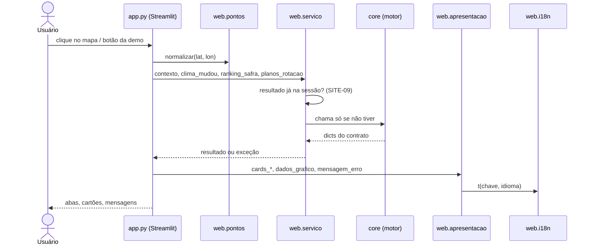

# Site Design

**Spec**: `.specs/features/site/spec.md`
**Status**: Draft

---

## Architecture Overview

`app.py` só monta a tela com Streamlit e encaminha gestos. Toda regra que muda o que o usuário vê — textos por idioma, arredondamento do clique, reuso de resultados, cartões, ordem dos planos, mensagens de erro — fica em funções puras de `web/`, testadas com pytest. Os gestos (botões, sliders, seletores, abas) são testados com `streamlit.testing.v1.AppTest` (Streamlit 1.67) com o motor e o banco substituídos por fakes. Conforma AD-001 (Streamlit), AD-004 (site não calcula; números do motor) e a escolha do usuário "app.py fino + módulos puros (Recommended)".



---

## Code Reuse Analysis

### Existing Components to Leverage

| Component | Location | How to Use |
| --------- | -------- | ---------- |
| Contratos do motor | `.specs/features/motor/spec.md`, `core/*.py` | `contexto`, `clima_mudou` (com `chuva_por_ano`, MOT-61), `ranking_safra`, `planos_rotacao` |
| Exceções | `core/erros.py` (feito) | `ErroPontoInvalido`, `ErroFonteDados` → mensagens SITE-07/08 |
| Pontos da demo | motor context.md | Coordenadas dos 4 botões |
| Fixtures de teste | `tests/unit/conftest.py` | Padrão de fakes do lote 1 |

### Integration Points

| System | Integration Method |
| ------ | ------------------ |
| Motor (`core/`) | Import direto por `web/servico.py` (injetável nos testes) |
| Banco (`core/db.py`, feature 3) | `criar_fazenda`, `listar_observacoes` via `web/servico.py`; ausente → recursos P3 escondidos |
| Mapa | `streamlit-folium` (`st_folium`) devolve `last_clicked` |

---

## Components

### web.i18n
- **Purpose**: Textos fixos da interface em pt/en/es.
- **Location**: `web/i18n.py`
- **Interfaces**: `IDIOMAS = {"Português": "pt", "English": "en", "Español": "es"}` · `t(chave, idioma) -> str` (idioma desconhecido → pt) · chave `limites` com o texto de SITE-30
- **Dependencies**: nenhuma

### web.pontos
- **Purpose**: Pontos da demo e normalização do clique.
- **Location**: `web/pontos.py`
- **Interfaces**: `DEMO: dict[rótulo, (lat, lon)]` · `normalizar(lat, lon) -> (lat, lon)` — 2 casas, longitude em [-180, 180] (SITE-03, SITE-37)
- **Dependencies**: nenhuma

### web.servico
- **Purpose**: Chamar o motor e o banco com reuso na sessão.
- **Location**: `web/servico.py`
- **Interfaces**: `Servico(motor=core, db=None, memoria: dict)` com `contexto`, `clima`, `ranking`, `planos`, `fazenda(lat, lon)` (reusa id, SITE-36), `observacoes()`; `db_disponivel()`
- **Dependencies**: `core` (injetável), `core.db` opcional

### web.apresentacao
- **Purpose**: Transformar os dicts do motor em dados de exibição.
- **Location**: `web/apresentacao.py`
- **Interfaces**: `selo(nivel, idioma)` · `cards_clima(r, idioma)` · `dados_grafico(r)` (DataFrame ano, chuva_mm, periodo) · `aviso_anos_sem_estacao(r, idioma)` · `cards_ranking(r, idioma)` · `cards_planos(r, idioma)` (atual primeiro) · `marcadores(obs)` · `popup(obs)` · `mensagem_erro(exc, idioma)` · `prioridades_vazias(r, s, so)`
- **Dependencies**: `web.i18n`

### app.py
- **Purpose**: Tela Streamlit: barra lateral (idioma, prioridades, data), mapa + botões da demo, faixa de contexto, 3 abas, painel "Por que confiar", recursos P3.
- **Location**: `app.py`
- **Interfaces**: script Streamlit; estado em `st.session_state` (`ponto`, `idioma`, `memoria`, `fazenda_id`)
- **Dependencies**: `web.*`, `streamlit`, `streamlit_folium`, `folium`

---

## Data Models

### Estado da sessão
```python
st.session_state = {
  "ponto": (lat, lon) | None,
  "idioma": "pt" | "en" | "es",
  "memoria": {("ranking", lat, lon, data, pesos, idioma): resultado, ...},
  "fazenda_id": {(lat, lon): id},
}
```

### Card de exibição (ranking)
`{titulo, nota, risco_txt, anos_quebra, nota_solo, retorno_txt, explicacao}`

---

## Error Handling Strategy

| Error Scenario | Handling | User Impact |
| -------------- | -------- | ----------- |
| `ErroPontoInvalido` | `mensagem_erro` → texto SITE-07; abas escondidas | "Esse ponto fica fora de terra firme…" |
| `ErroFonteDados` | texto SITE-08; abas escondidas | "Os dados da NASA estão indisponíveis…" |
| `ValueError` do motor | Mensagem junto ao controle (SITE-39) | Corrige o campo |
| Erro em uma aba | Capturado por aba (SITE-40) | As outras abas continuam |
| `core/db.py` ausente | Recursos P3 não aparecem | Site funciona sem bot |

---

## Risks & Concerns

| Concern | Location (file:line) | Impact | Mitigation |
| ------- | -------------------- | ------ | ---------- |
| `AppTest` não simula clique do `streamlit-folium` | `app.py` | Clique no mapa sem teste de gesto | Clique só grava `session_state["ponto"]` via `web.pontos.normalizar` (testado); AppTest injeta `ponto` direto; walk confere o clique real |
| Motor T10–T17 ainda não implementado | `core/` | Site real sem dados | Testes usam fake do motor; integração real no walk após o motor |
| `core/db.py` é da feature 3 | `app.py` (P3) | P3 sem banco real | `Servico.db` injetável; fake nos testes; P3 escondido sem banco |
| Rerun do Streamlit a cada interação | `app.py` | Chamadas repetidas ao motor | `memoria` na sessão (SITE-09) |
| Layout de 390 px não é testável pelo AppTest | `app.py` | Celular quebrado sem aviso | Proof por walk em janela de 390 px |

---

## Tech Decisions

| Decision | Choice | Rationale |
| -------- | ------ | --------- |
| Reuso de resultado | Dict em `st.session_state` em vez de `st.cache_data` | SITE-09 é "na mesma sessão"; dict é testável sem Streamlit |
| Testes de gesto | `AppTest.from_file("app.py")` com `monkeypatch` em `web.servico` | Mesma tela que o usuário vê, sem navegador |
| Idioma desconhecido na UI | Cai para pt | Interface tem só 3 opções; pt é o padrão |
